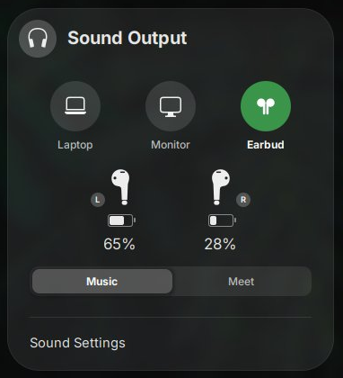

# Sound Output Tiles

A GNOME Shell extension that replaces the Quick Settings sound output list with one tile per physical device.



## Features

- **One tile per device.** Laptop speakers, monitors (HDMI/DisplayPort) and Bluetooth headsets each get a big icon and a short label, instead of one row per port.
- **Mode switch.** When a device has more than one profile, such as a Bluetooth headset's high-quality and hands-free profiles, a **Music / Meet** switch appears under the tiles.
- **Battery levels.** Shows the battery of the active Bluetooth headset via UPower. Some Xiaomi earbuds also get separate left/right levels and a charging indicator, read from their Bluetooth LE advertisements.

## Requirements

- GNOME Shell 50 or 51
- PipeWire or PulseAudio
- BlueZ, for the per-earbud battery levels

## Install

```sh
git clone https://github.com/erfanium/sound-output-tiles.git \
  ~/.local/share/gnome-shell/extensions/sound-output-tiles@erfanium.local
gnome-extensions enable sound-output-tiles@erfanium.local
```

Log out and back in (on Wayland) to load it.

## License

GPL-2.0-or-later
